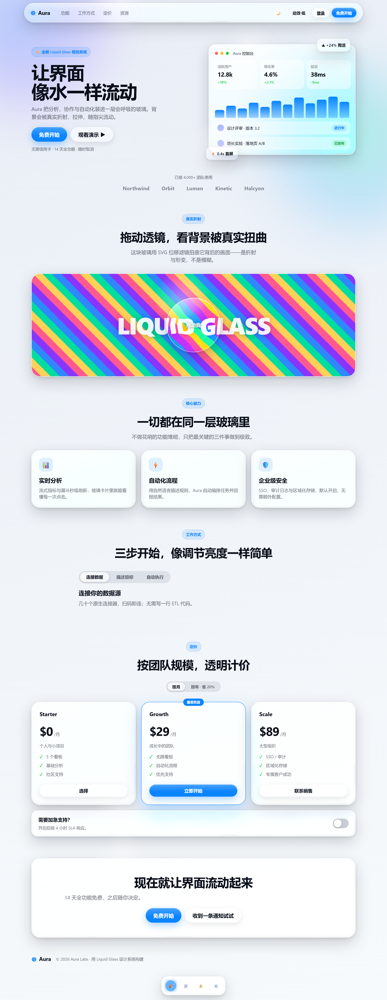
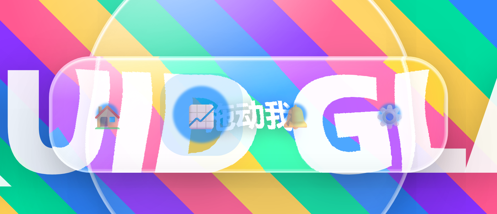

# Liquid Glass 设计系统（Design Skill for AI Coding Agents）

一套**可直接落地**的 iOS 液态玻璃（Liquid Glass / glassmorphism）Web 设计系统，打包为 Agent Skill 格式，供 Claude Code、Codex、Cursor 等 AI 编码助手在「美化界面 / 液态玻璃 / 出设计规范」任务中直接调用；同时附带静态与 React 两套可运行示例。

## 特性
- **设计规范 token 化**：配色 / 字号 / 字重 / 间距 / 栅格 / 圆角 / 边框 / 阴影 / 动效曲线全部为 CSS 变量。
- **玻璃效果分层**：`@supports` 降级（不支持 backdrop-filter 时退半透明纯色）；进阶「真折射」用 SVG `feTurbulence + feDisplacementMap` 扭曲背后画面，非单纯模糊。
- **组件代码**：React（顶部含 "use client"）实现 Button / Input / Card / Switch / SegmentedControl / Modal / Toast / Tabs / Dock；另附 Vue / 原生替换说明。
- **两套 Demo**：静态落地页（零依赖）+ React + Vite + framer-motion 交互版（真实折射 + 水滴融合 Dock）。
- **资源清单**：references/resources.md 汇总经核查许可证的开源 UI 库 / 模板 / design skill，标注许可证与「待核实」项。

## 目录结构
```
design-system-liquid-glass/
├─ SKILL.md                     # Agent Skill 入口（YAML frontmatter: name / description）
├─ README.md                    # 本文件
├─ .gitignore
├─ references/
│  ├─ design-spec.md            # 配色/字号/间距/圆角/阴影/动效/玻璃参数/跨框架/兼容性
│  └─ resources.md              # 开源资源清单（项目/链接/技术栈/许可证/适用场景/移植难度）
├─ assets/
│  ├─ tokens.css                # 亮/暗色 token、--dur-* / --ease-*
│  ├─ components.css            # .glass/.btn/.field/.card/.switch/.seg/.overlay.modal/.toast/.tabs/.dock + @supports 降级
│  └─ ui.tsx                    # React 组件源码（19 个导出）
├─ examples/                    # 静态落地页 demo（HTML/CSS/JS，开箱即看）
│  ├─ index.html / landing.css / landing.js / README.md
│  └─ _preview-desktop.png / _preview-mobile.png
└─ examples-react/              # React + Vite + framer-motion 交互 demo
   ├─ index.html / package.json / vite.config.js
   ├─ src/
   │  ├─ main.jsx / App.jsx / styles/liquid.css
   │  ├─ state/app-state.jsx
   │  ├─ liquid/{GlassFilterDefs,LiquidGlass}.jsx, useLiquidSupport.js
   │  └─ components/{Nav,Hero,RefractionDemo,Features,WorkflowTabs,Pricing,CTA,Footer,Dock,Modal,Toasts}.jsx, ui/{Segmented,Switch}.jsx
   ├─ README.md
   └─ _preview-*.png
```

## 作为 Agent Skill 使用
本目录遵循 Agent Skills 约定（根目录 `SKILL.md` + YAML frontmatter 的 `name` / `description`）。把它放到运行时的 skills 目录即可被识别：

```bash
# 方式一：克隆到用户级 skills 目录（以 Claude Code 为例）
git clone https://github.com/<你的账号>/design-system-liquid-glass.git \
  ~/.claude/skills/design-system-liquid-glass

# 方式二：放进项目内（团队共享）
git clone https://github.com/<你的账号>/design-system-liquid-glass.git \
  .agents/skills/design-system-liquid-glass
```
> 不同运行时目录名可能为 `~/.claude/skills` / `.agents/skills` / `.codex/skills` 等，以其文档为准；只要保留 `SKILL.md` 即可。

## 在页面中使用（React）
1. 引入 `assets/tokens.css`（含亮/暗 CSS 变量）到根样式；
2. 引入 `assets/components.css`；
3. 从 `assets/ui.tsx` 拷贝所需组件，或直接参考 `examples-react/` 的用法；
4. 选择其它开源库时先读 `references/resources.md`，注意许可证与「待核实」项。
Vue / 原生栈：按 `references/design-spec.md` 末节把 CSS 变量与组件类名平移到对应框架。

## 运行示例
```bash
# 静态版：直接打开，或起个静态服务器
cd examples && python -m http.server 8080     # 浏览器访问 http://localhost:8080

# React 交互版
cd examples-react
npm install
npm run dev        # http://localhost:5173
npm run build      # 产物 dist/
npm run preview    # http://localhost:4173
```

## 预览
桌面端（React 版）与 Dock 水滴融合特写：




移动端预览见 [examples-react/_preview-mobile.png](examples-react/_preview-mobile.png)；真折射演示见 [examples-react/_preview-refraction.png](examples-react/_preview-refraction.png)。

## 浏览器兼容与降级
- 支持 `backdrop-filter`（Chrome / Edge / Safari 16+）：启用玻璃模糊 / 折射。
- 老版 Firefox / 不支持 `backdrop-filter`：`@supports` 自动退化为半透明纯色，布局不塌陷。
- 真实折射（`backdrop-filter: url(#filter)`）仅 Chromium 系可用；Safari/Firefox 走磨砂玻璃降级。
- 全部动效遵循 `prefers-reduced-motion`。

## 资源与致谢
`references/resources.md` 列出参考的开源 UI 组件库 / 模板 / design skill，逐条注明仓库、技术栈、许可证、适用场景与移植成本。**这些是参考链接，不是本仓库打包的代码**；其许可证以各自仓库为准，商用前请复核（尤其标注「待核实」项）。

## 许可证
本仓库暂未内置 LICENSE。若要开源并被其他 agent / 团队复用，建议添加 `LICENSE`：
- **MIT（推荐）**：最宽松、最易被其他 agent 与团队集成；
- **Apache-2.0**：需保留专利授权条款时使用。
确定后在根目录加入 `LICENSE` 文件，并把本节改为对应许可证名称。

## 维护约定
- 颜色 / 圆角 / 阴影一律引用 `tokens.css` 变量。
- 新增组件请同时补 `assets/ui.tsx` 实现与 `assets/components.css` 样式，并更新本 README 的组件清单。
- 修改 design token 时同步 `references/design-spec.md`。